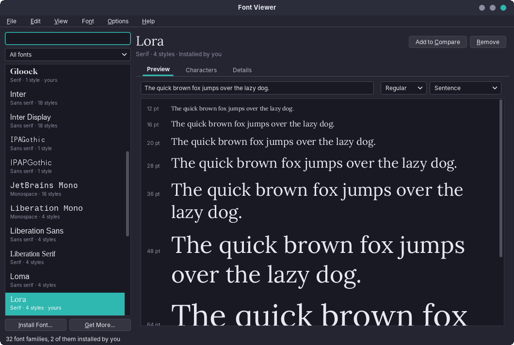
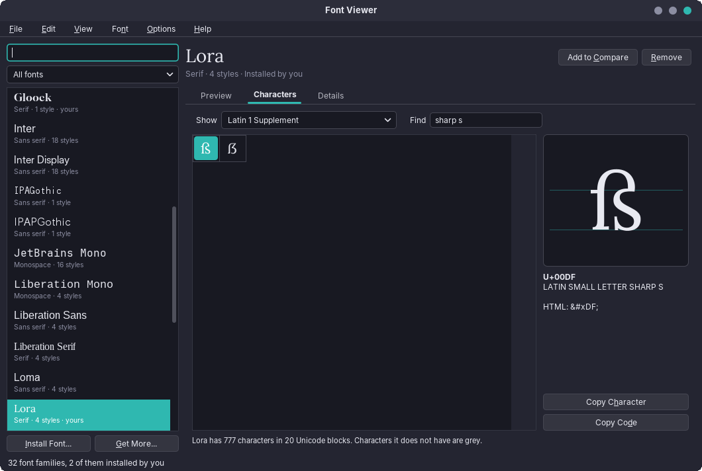
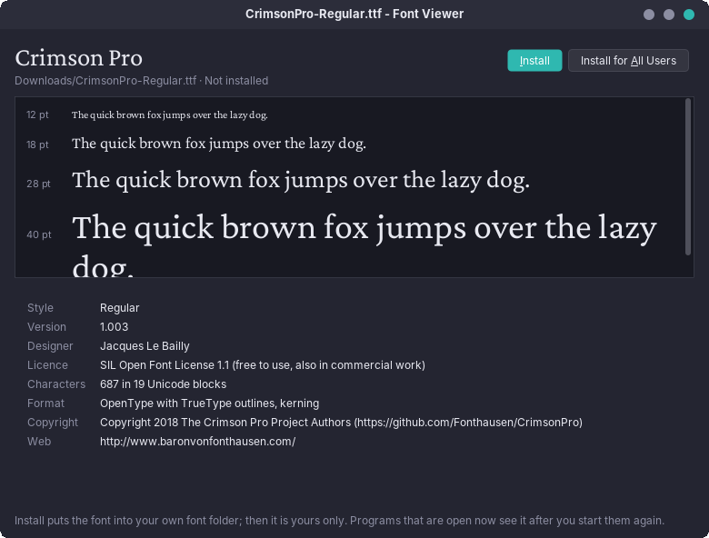

# amade-fontviewer

**amade-fontviewer** (Font Viewer) is the font program of the [amadeOS](https://github.com/amadeos-eu/amadeos) desktop. It lists every font on the computer, each written in itself, shows a sample text in many sizes and all characters of a font, compares fonts and installs font files you downloaded. Built like the other amadeOS applications.




## Features

- **Font list**: all font families from fontconfig, each name drawn in its own font, with its kind (serif, sans serif, monospace, handwriting, display, symbols), the number of styles and *yours* for the fonts you installed. Search by name and filter by *My fonts* or a kind.
- **Preview**: your own sample text or a ready one (sentence, alphabet, numbers, paragraph) from 12 to 64 pt, in every style of the family. The text stays when you choose another font.
- **Characters**: every character of the font by Unicode block (missing ones grey), search by name (`sharp s`) or code (`U+00DF`, `00df`), the chosen character large with base line and x-height, its code, Unicode name and HTML entity; *Copy Character* and *Copy Code*.

  
- **Details**: styles, version, designer, licence (with a plain note for free licences such as the OFL), number of characters and Unicode blocks, languages (from fontconfig), format (TrueType or PostScript outlines, kerning, variable font), where it is installed, files, copyright, web site and, for system fonts, the Debian package.
- **Compare** up to six fonts with the same text and size, each in a style of its own.
- **Open a font file** (`.ttf`, `.otf`, `.ttc`, `.otc`, also Type 1 `.pfb`/`.pfa`): a double click in Files opens a small window with the font's preview and details and the buttons **Install** (for you, into `~/.local/share/fonts`) and **Install for All Users** (into `/usr/local/share/fonts/amadeos`, after the administrator's password). An installed font says so and offers *Show in Font Viewer*.

  
- **Install** from the main window too (*File → Install Font…*, or drop font files on the window), **Remove** your own fonts (to the trash) and fonts installed for all users. Fonts that came with a package are removed in Software.
- **Get More Fonts…** opens Software with the font packages.
- Five languages (English, Deutsch, Français, Español, Italiano), following the amadeOS desktop language; *Options → Language* overrides it.
- Theme colours, Motif and Horizon look from [amade-commons](https://github.com/amadeos-eu/amade-commons).

Programs that are already running see a new font only after a restart (Java and LibreOffice read the font list once); the Font Viewer itself draws every font straight from its file, so it shows new fonts at once.

### Keys

| Key | Action |
|---|---|
| Ctrl+O | Open a font file |
| Ctrl+I | Install fonts |
| Ctrl+F | Find a font |
| Ctrl+1, Ctrl+2, Ctrl+3 | Preview, Characters, Details |
| Ctrl+D | Add the font to the comparison |
| Ctrl+K | Compare fonts |
| Ctrl+Shift+C | Copy the chosen character |
| Delete | Remove the font |
| F5 | Reload the font list |
| F1 | Handbook |

## Platforms

Linux (deb). The list comes from fontconfig (`fc-list`), installing runs `fc-cache`, the trash is `gio trash`, *Install for All Users* uses `pkexec` with the helper `/usr/libexec/amade-fontviewer-helper` and the polkit action `eu.amadeos.apps.fontviewer.install`.

## Architecture

Java 25, Swing and Guice; start-up, theme and language come from `AmadeApplication` in amade-commons.

| Package | Contents |
|---|---|
| `bootstrap` | `AmadeFontViewerApplication` (font files and `--family=NAME` as arguments), `FontViewerModule`, `Windows` (main window and file windows) |
| `domain` | `FontFace`, `FontFamily`, `Category`, `FontScope`, `FontDetails`, `Outlines`, `Coverage`, `UnicodeBlocks`, `SampleText`, `FontFiles`, `LanguageNames` |
| `repository` | `FontViewerPreferences` (`~/.config/amadeos/fontviewer/fontviewer.properties`: sample text, last family, page, comparison) |
| `service` | `FontCatalog` (fc-list), `FontTables` (reads the `name`, `OS/2`, `cmap`, `maxp` tables of TrueType and OpenType files and collections), `SerifShape`, `FontLoader`, `FontInspector`, `FontInstaller`, `FontPlaces`, `PackageOwner` (`dpkg -S`), `DesktopOpener` |
| `ui.main` | main window, presenter, menus, font list |
| `ui.parts` | `Waterfall`, `CharactersPanel`, `CharacterGrid`, `GlyphView`, `DetailsPanel`, `FontChooser` |
| `ui.compare` | `CompareWindow` |
| `ui.file` | the window for a font file: `FileWindow`, `FilePresenter` |

Fonts are drawn with `Font.createFonts` from their files, not by family name, so a file that is not installed looks right and a font installed a moment ago needs no restart. The presenters know their windows only through the `MainView` and `FileView` interfaces, so the tests drive the list, filters, install and remove without Swing.

The helper for all users gets the font's bytes on standard input and a file name, never a path: root does not open files of the user. It checks the name (ASCII letters, digits, `._+ -`, a font extension) and the file's first bytes, writes only into `/usr/local/share/fonts/amadeos` and runs `fc-cache` there.

## Build and run

```sh
./gradlew run                                         # the font list
./gradlew run --args="Downloads/Some-Font.ttf"         # a font file, as from Files
./gradlew run --args="--family=Caladea"               # the list with a family chosen
./gradlew test                                        # Swing tests need a display: xvfb-run ./gradlew test
./gradlew deb                                         # build/distributions/amade-fontviewer_<version>_all.deb
./gradlew installToAmadeOs                            # the .deb into ../amadeos/config/packages.chroot/ for the ISO build
```

If `../amade-commons` is checked out next to this repository, Gradle builds against that checkout instead of the published version.

## Planned

- Variable fonts with sliders for weight and width (Java draws only the default instance today)
- Converting WOFF and WOFF2 web fonts
- Font collections ("for letters") and a printable specimen sheet as PDF
